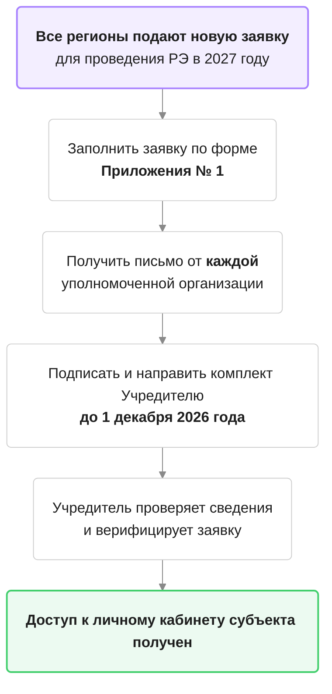

# Как подать заявку на проведение регионального этапа

Заявку подаёт организатор регионального этапа — орган исполнительной власти субъекта Российской Федерации, осуществляющий государственное управление в сфере образования ([п. 16 Порядка](/docs/poryadok/#p16)).

**Для проведения регионального этапа в 2027 году новую заявку необходимо подать всем регионам**, в том числе тем, которые проводили Олимпиаду ранее. Это связано с изменением правил проведения и условий поручения на обработку персональных данных.

После верификации новая заявка будет действовать до её отзыва. В последующие годы организатор сможет подтверждать участие и обновлять сведения в личном кабинете субъекта.

[Скачать форму заявки и письма уполномоченной организации (Приложение № 1, DOCX)](/files/2027/appendices/requirements-appendix-1.docx){: .btn .btn-primary }

## Когда нужно подать новую заявку

Для регионального этапа 2027 года заявка направляется Учредителю **не позднее 1 декабря 2026 года**.

В этом году новую заявку подают все регионы. Обычное правило о том, что повторная заявка требуется только в отдельных случаях, начнёт применяться после верификации новой заявки.

В последующие годы, если заявка продолжает действовать и не требует изменений, до 1 декабря будет достаточно подтвердить участие в очередном региональном этапе и обновить сведения в личном кабинете субъекта ([п. 14 Требований](/docs/trebovaniya-re/#p14)).

## Порядок подачи

## Что указать в заявке

### 1. Организатор

- субъект Российской Федерации;
- полное наименование органа исполнительной власти;
- адрес места нахождения;
- ИНН и ОГРН.

### 2. Уполномоченные организации

**В заявке уполномоченная организация (УО) — прежде всего организация, которой поручается обработка персональных данных участников.** Она может выполнять организационные функции при проведении регионального этапа, но её указание в заявке означает принятие поручения Учредителя на обработку персональных данных на условиях [п. 11 Требований](/docs/trebovaniya-re/#p11).

По каждой УО указываются полное наименование, адрес, ИНН и ОГРН. Организатор может уполномочить одну или несколько организаций на проведение регионального этапа полностью или частично ([п. 17 Порядка](/docs/poryadok/#p17)). От каждой указанной УО к заявке обязательно прилагается отдельное письмо о принятии поручения на обработку персональных данных.

### 3. Площадки проведения

Для каждой известной на момент подачи заявки площадки указываются наименование и адрес. При нескольких площадках сведения заполняются отдельно по каждой.

### 4. Публичные контакты

Эти сведения будут опубликованы на официальном сайте Олимпиады:

- сайт или веб-страница регионального этапа;
- общий адрес электронной почты оргкомитета;
- общий контактный телефон.

Следует указывать общие контакты оргкомитета, а не личные контакты сотрудников.

### 5. Служебные контакты

Эти сведения не публикуются:

- основной служебный адрес электронной почты — на него поступят данные для доступа к личному кабинету, уведомления и протоколы перепроверки МПМК;
- не менее двух представителей уполномоченной организации: ФИО, должность, организация, электронная почта и телефон;
- сотрудник, ответственный за конфиденциальный перечень материально-технического обеспечения;
- председатель жюри или другое лицо для связи с МПМК в дни туров и во время проверки.

Для ответственного за МТО и представителя жюри указываются ФИО, должность, электронная почта, телефон, наличие аккаунта в MAX и дополнительные средства связи.

## Что приложить

К заявке необходимо приложить **отдельное письмо от каждой уполномоченной организации** о принятии поручения Учредителя на обработку персональных данных участников.

Письмо:

- оформляется по форме, входящей в Приложение № 1;
- печатается на бланке уполномоченной организации;
- подписывается её руководителем или уполномоченным должностным лицом;
- содержит полное наименование, адрес, ИНН и ОГРН организации;
- подтверждает принятие условий обработки и защиты персональных данных, установленных [п. 11 Требований](/docs/trebovaniya-re/#p11).

Заявка без писем от всех перечисленных уполномоченных организаций не проходит верификацию.

## Как подписать и направить

Заявку подписывает руководитель организатора или уполномоченное должностное лицо. В форме указываются должность, подпись, ФИО, дата и количество прилагаемых писем; при наличии ставится печать.

Документы официально направляются Учредителю через систему электронного документооборота, на почту [maxwell@phystech.edu](mailto:maxwell@phystech.edu) и иными способами электронной коммуникации. После проверки Учредитель верифицирует заявку и направляет данные для доступа к личному кабинету субъекта на указанный основной служебный адрес.

## Чек-лист перед отправкой

- [ ] Использована актуальная форма Приложения № 1.
- [ ] Указаны реквизиты организатора и всех уполномоченных организаций.
- [ ] Перечислены площадки проведения.
- [ ] Публичные контакты являются общими контактами оргкомитета.
- [ ] Указан рабочий основной служебный адрес электронной почты.
- [ ] Назначены не менее двух представителей уполномоченной организации.
- [ ] Указаны ответственный за перечень МТО и представитель жюри.
- [ ] Получено подписанное письмо от каждой уполномоченной организации.
- [ ] В заявке указано правильное количество приложенных писем.
- [ ] Заявка подписана руководителем или уполномоченным должностным лицом.
- [ ] Документы направлены Учредителю не позднее 1 декабря.

## Нормативные документы

- [Требования к проведению регионального этапа, пункты 9–14](/docs/trebovaniya-re/#p9)
- [Приложение № 1: форма заявки и письма уполномоченной организации](/files/2027/appendices/requirements-appendix-1.docx)
- [Порядок проведения Олимпиады](/docs/poryadok/)
