# Схема участия в региональном этапе
{: .no_toc }

Схема описывает путь участника от допуска к региональному этапу до прихода на тур.

Ссылки **П.N** ведут к пунктам [Порядка проведения Олимпиады](/docs/poryadok/), **Т.N** — к пунктам [Требований к проведению регионального этапа](/docs/trebovaniya-re/).

**ДРЭ** — дата начала регионального этапа, день практического тура.

```mermaid
---
config:
  securityLevel: loose
  flowchart:
    curve: basis
    nodeSpacing: 40
    rankSpacing: 36
    padding: 22
    wrappingWidth: 320
  themeVariables:
    fontSize: 17px
    lineColor: "#8a8a8a"
    edgeLabelBackground: "#ffffff"
---
flowchart TD
    U0("`**Обучающийся 5–8 класса**, в том числе на семейном образовании или самообразовании
    *П.28*`"):::good
    Q0("`**В субъекте школы проводится РЭ?**
    *П.18, П.31*`"):::dec
    X0("`Участие в РЭ невозможно: другой субъект не допускается
    *П.31*`"):::bad
    Q1("`**Выполнял задания МЭ ВсОШ по физике текущего года за 7 или 8 класс?**
    *П.2, П.29–30*`"):::dec
    X1("`Не допускается к РЭ`"):::bad
    U1("`Класс, за который писал МЭ, — класс участия; сохраняется на РЭ и ЗЭ
    *П.29*`"):::step
    Q2("`**Набрал не меньше минимального балла, установленного организатором для класса?**
    *П.30, Т.4*`"):::dec
    X2("`Не допускается к РЭ`"):::bad
    Q3("`**Включён в список участников, опубликованный не позднее ДРЭ−25?**
    *Т.4*`"):::dec
    X3("`Не допускается к выполнению заданий
    *Т.36*`"):::bad
    U2("`Родитель в ЛК участника на сайте Олимпиады указывает школу и субъект; при семейном обучении — школу прикрепления
    *Т.22*`"):::step
    U3("`ЛК показывает тексты согласий с наименованиями организатора и УО субъекта; родитель подтверждает ознакомление с Порядком и Требованиями
    *П.32, Т.22*`"):::step
    Q5("`**Родитель дал согласия на обработку и на распространение до ввода сведений?**
    *П.33, Т.22*`"):::dec
    X5("`Участие невозможно
    *П.33*`"):::bad
    U4("`Ввести ФИО, дату рождения, класс обучения, класс участия, контакты участника; ФИО и контакты родителя
    *Т.22*`"):::step
    U5("`В ЛК формируются согласия участника (Прил. №2); распечатать, подписать родителем, а участнику с 14 лет — тоже подписать
    *Т.23–24*`"):::step
    Q6("`**УО требует доп. регистрацию на своём ресурсе?**
    *Т.25*`"):::dec
    U6("`Зарегистрироваться на ресурсе региона, дать ему отдельное согласие, подготовить доп. документы
    *Т.25*`"):::step
    U7("`Следить за публикациями: сроки, площадки, квота (Т.4); площадка и рассадка (Т.25, Т.30); решение о калькуляторах (Т.43). Участие — только на площадке своего субъекта
    *П.31*`"):::step
    U8("`Взять с собой: подписанные согласия и доп. документы, если запрашивались (Т.36); свидетельство о рождении (до 14 лет), паспорт РФ или иной документ; без фото — справка из школы с фото 3×4 и печатью (Т.35); непрограммируемый калькулятор без связи и камеры
    *Т.42–43*`"):::step
    N1("`**Пришёл на тур**: проверка документа, сбор согласий, сверка со списком и ЛК субъекта (Т.35–36); калькулятор — дежурному (Т.43)`"):::good

    U0 --> Q0
    Q0 -- Да --> Q1
    Q1 -- Да --> U1 --> Q2
    Q2 -- Да --> Q3
    Q3 -- Да --> U2 --> U3 --> Q5
    Q5 -- Да --> U4 --> U5 --> Q6
    Q6 -- Нет --> U7
    Q6 -- Да --> U6 --> U7
    U7 --> U8 --> N1
    Q0 -- Нет --> X0
    Q1 -- Нет --> X1
    Q2 -- Нет --> X2
    Q3 -- Нет --> X3
    Q5 -- Нет --> X5
    Q0 ~~~ Q1
    Q0 ~~~ Q1
    Q1 ~~~ U1
    Q1 ~~~ U1
    Q2 ~~~ Q3
    Q2 ~~~ Q3
    Q3 ~~~ U2
    Q3 ~~~ U2
    Q5 ~~~ U4
    Q5 ~~~ U4

    click U0 "/docs/poryadok/#p28" "Порядок, пункт 28" _self
    click Q0 "/docs/poryadok/#p18" "Порядок, пункты 18 и 31" _self
    click X0 "/docs/poryadok/#p31" "Порядок, пункт 31" _self
    click Q1 "/docs/poryadok/#p2" "Порядок, пункты 2 и 29–30" _self
    click U1 "/docs/poryadok/#p29" "Порядок, пункт 29" _self
    click Q2 "/docs/poryadok/#p30" "Порядок, пункт 30; Требования, пункт 4" _self
    click Q3 "/docs/trebovaniya-re/#p4" "Требования, пункт 4" _self
    click X3 "/docs/trebovaniya-re/#p36" "Требования, пункт 36" _self
    click U2 "/docs/trebovaniya-re/#p22" "Требования, пункт 22" _self
    click U3 "/docs/poryadok/#p32" "Порядок, пункт 32; Требования, пункт 22" _self
    click Q5 "/docs/poryadok/#p33" "Порядок, пункт 33; Требования, пункт 22" _self
    click X5 "/docs/poryadok/#p33" "Порядок, пункт 33" _self
    click U4 "/docs/trebovaniya-re/#p22" "Требования, пункт 22" _self
    click U5 "/docs/trebovaniya-re/#p23" "Требования, пункты 23–24" _self
    click Q6 "/docs/trebovaniya-re/#p25" "Требования, пункт 25" _self
    click U6 "/docs/trebovaniya-re/#p25" "Требования, пункт 25" _self
    click U7 "/docs/trebovaniya-re/#p4" "Требования, пункты 4, 25, 30 и 43" _self
    click U8 "/docs/trebovaniya-re/#p36" "Требования, пункты 35–36 и 42–43" _self
    click N1 "/docs/trebovaniya-re/#p35" "Требования, пункты 35–36 и 43" _self

    classDef step fill:#ffffff,stroke:#cfcfcf,stroke-width:1px,color:#1f1f1f
    classDef dec fill:#f3eeff,stroke:#a882ff,stroke-width:2px,color:#1f1f1f
    classDef bad fill:#fff0f0,stroke:#fb464c,stroke-width:2px,color:#1f1f1f
    classDef good fill:#ecfaf1,stroke:#44cf6e,stroke-width:2px,color:#1f1f1f
```

Обозначения: ■ фиолетовый — ветвление «Да / Нет»; ■ красный — недопуск; ■ зелёный — начало и завершение пути.

